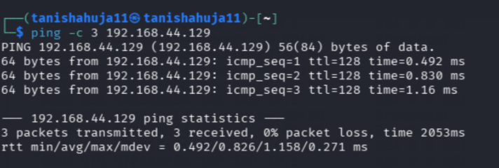
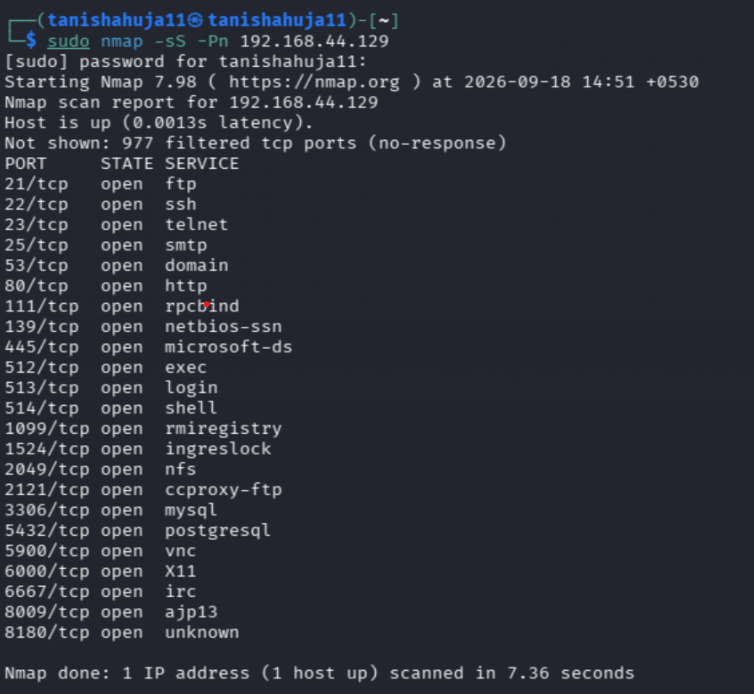
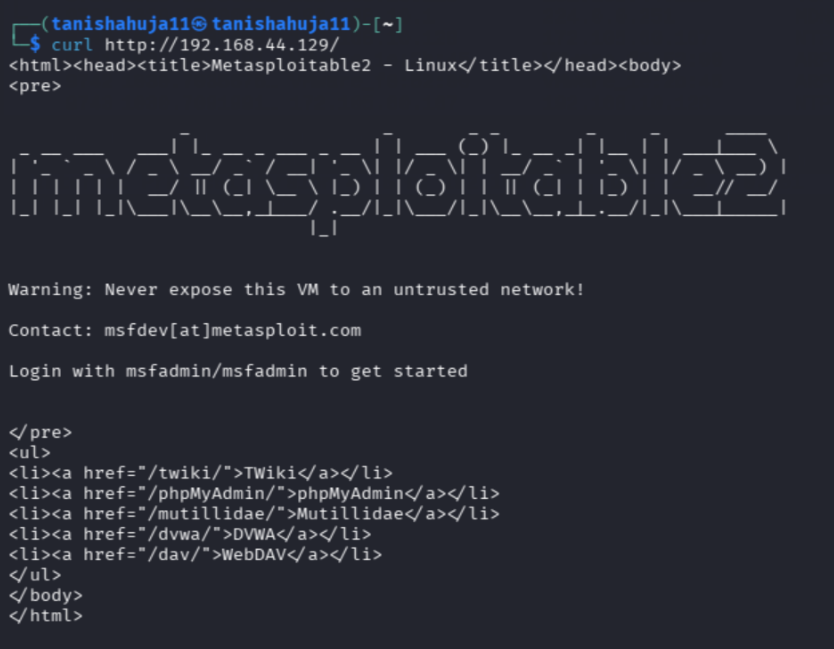
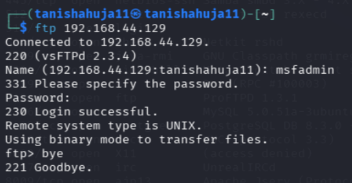
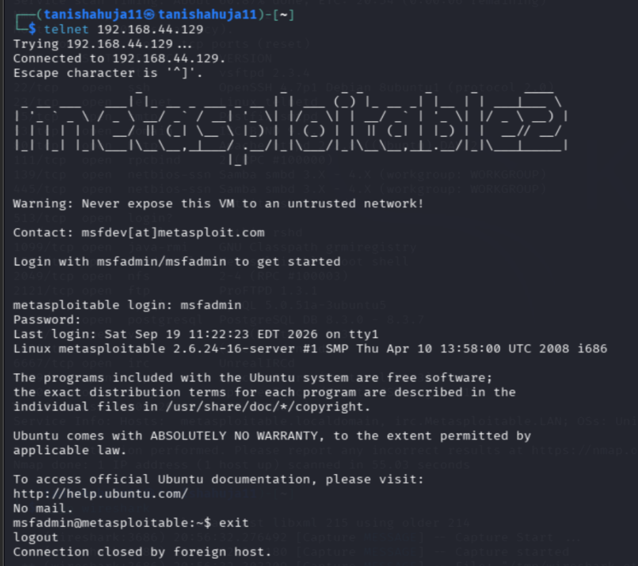
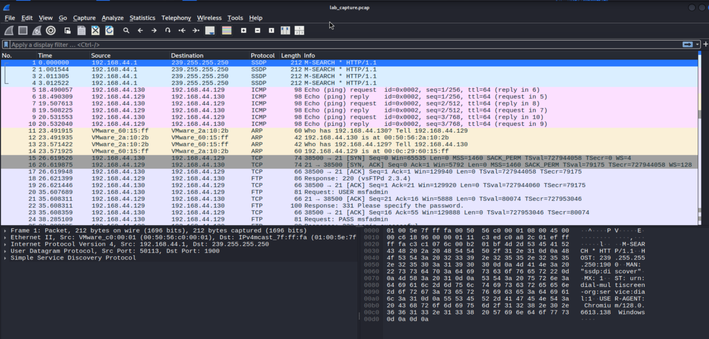

# Experiment 3 — Basic Network Traffic Analysis with Wireshark

## Aim

To capture and analyze network traffic using Wireshark and identify cleartext information in a controlled lab environment.

## Requirements

- Kali Linux
- Wireshark
- Metasploitable 2
- VirtualBox/VMware
- Host-Only Adapter/Internal Network

## Lab Configuration

- Kali Linux: `192.168.44.130`
- Metasploitable 2: `192.168.44.129`
- Network: Isolated lab / host-only network

## Procedure

### Step 1: Verify Connectivity

Check connectivity between Kali Linux and Metasploitable 2.

**Command:**

```bash
ping -c 3 192.168.44.129
```

A successful reply confirms connectivity between the systems.

**Evidence:**



### Step 2: Perform Quick Port/Service Scan

Scan the target machine to identify open ports and services.

**Command:**

```bash
sudo nmap -sS -Pn 192.168.44.129
```

The scan displays open ports and the corresponding services running on the target.

**Evidence:**



### Step 3: Start Wireshark Capture

Open Wireshark in Kali Linux:

```bash
wireshark
```

Select the network interface connected to the lab network, such as `eth1`, and start the packet capture.

### Step 4: Generate Lab Traffic

While Wireshark is capturing packets, generate network traffic from Kali Linux.

#### HTTP Traffic

```bash
curl http://192.168.44.129/
```



#### FTP Traffic

```bash
ftp 192.168.44.129
```

Use the lab credentials when prompted, then exit the FTP session.



#### Telnet Traffic

```bash
telnet 192.168.44.129
```

Log in using the lab credentials and exit the session after the traffic has been captured.



These activities generate packets that can be captured and analyzed in Wireshark.

### Step 5: Analyze Plaintext Traffic in Wireshark

Use Wireshark display filters to examine the captured traffic.

**All traffic to/from target:**

```text
ip.addr == 192.168.44.129
```

**FTP commands/credentials:**

```text
ftp.request.command == "USER" || ftp.request.command == "PASS"
```

**Telnet traffic:**

```text
telnet
```

**HTTP traffic:**

```text
http
```

**HTTP Basic Authentication:**

```text
http.authorization
```

These filters help identify protocols and information transmitted in plaintext within the controlled lab environment.

**Evidence:**



### Step 6: Save Capture and Export Evidence

After completing the analysis, stop the capture.

In Wireshark:

**File → Save As**

Save the capture as:

```text
lab_capture.pcap
```

The captured file can be retained as evidence for the lab report.

## Result

Network traffic was successfully captured and analyzed using Wireshark. HTTP, FTP, Telnet and other network traffic were examined in the controlled lab environment.

## Conclusion

The experiment demonstrated how Wireshark can be used to capture network packets, analyze protocols and identify information transmitted through network traffic.
