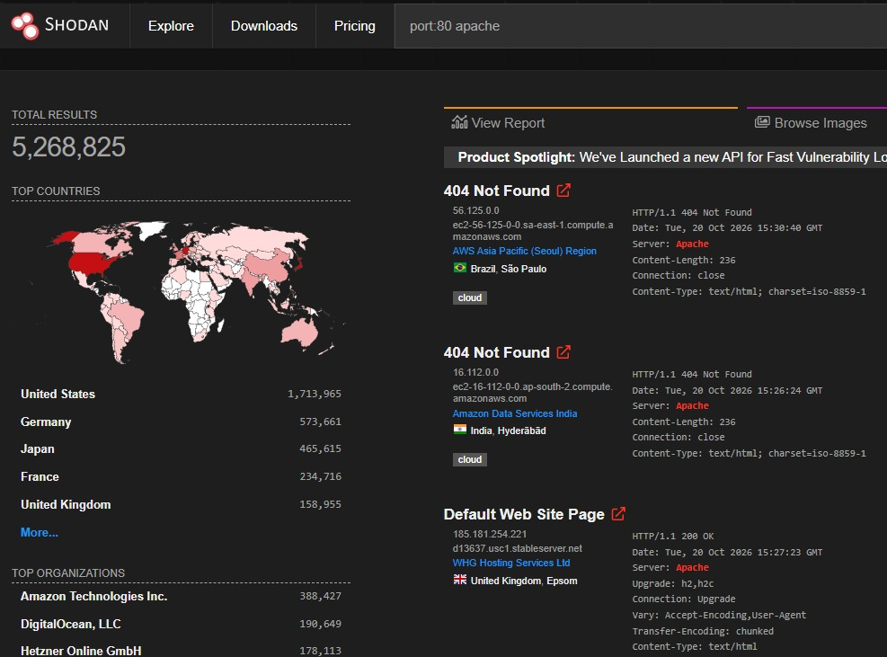
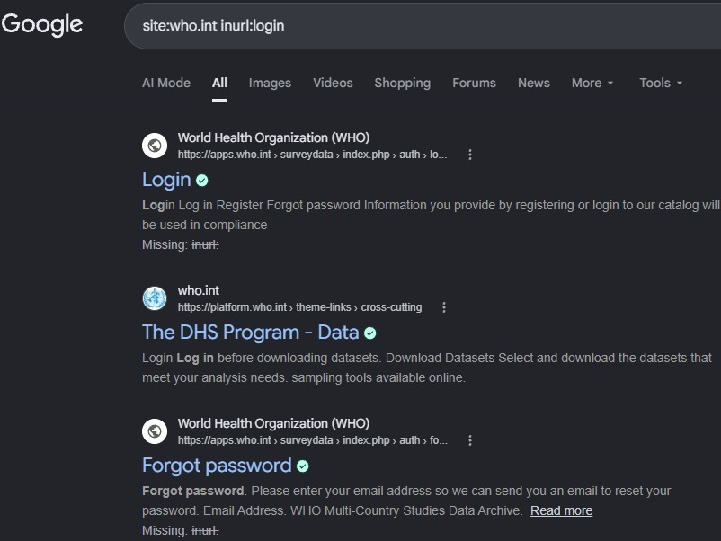
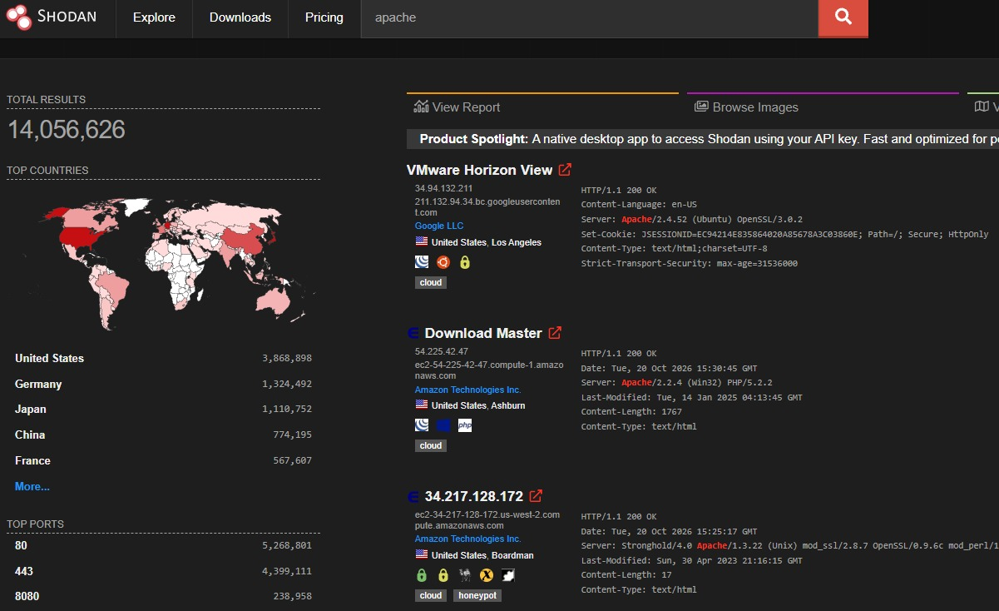
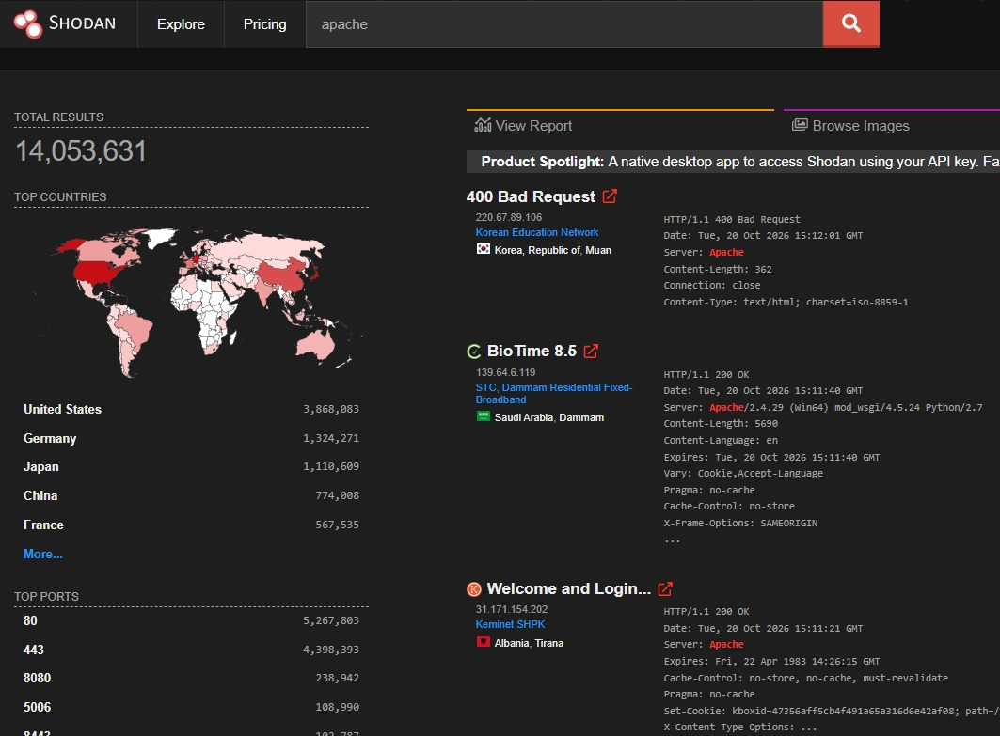

# Experiment 7: Using OSINT Tools for Reconnaissance

## Aim
To perform passive reconnaissance using Google Dorks and Shodan to collect publicly available information.

## Requirements
- Computer with internet access
- Web browser
- Google Search
- Shodan

## Theory
Open-Source Intelligence (OSINT) is the collection and analysis of information from publicly available sources. Google Dorks use advanced search operators to locate indexed information. Shodan displays information about internet-connected services, such as ports and server banners.

## Procedure

### Step 1: Open Google Search
Open a browser and visit Google Search.

### Step 2: Perform Google Dorking
Use advanced search operators to locate indexed information. The supplied examples include `site:who.int inurl:login` and `site:who.int filetype:pdf`. Search results alone do not prove a vulnerability.

### Step 3: Analyze Google results
Review results and record relevant public pages or documents. Do not access accounts or private data without authorization.

### Step 4: Open Shodan
Visit [Shodan](https://www.shodan.io/) and sign in if required.

### Step 5: Search and analyze Shodan results
The supplied Shodan screenshot shows results for `port:80 apache`. Results may include IP addresses, ports, HTTP responses, and server banners. Broad searches return unrelated systems and do not prove that any listed system is vulnerable.

### Step 6: Record findings
Record relevant publicly visible information for an authorized assessment. Avoid collecting or publishing unnecessary personal or sensitive information.

## Result
Google Dorks returned publicly indexed pages matching the demonstrated queries, while Shodan displayed internet-facing service metadata such as ports, HTTP responses, and server banners.

## Conclusion
The experiment demonstrated how Google Dorks and Shodan support passive reconnaissance by revealing publicly indexed information and details about internet-facing services. Findings must be interpreted carefully and verified before drawing security conclusions.

## Supplied lab-record pages

## Scope and safety
Use these tools only for legitimate learning and authorized assessments. Public visibility does not grant permission to probe or exploit a system.
